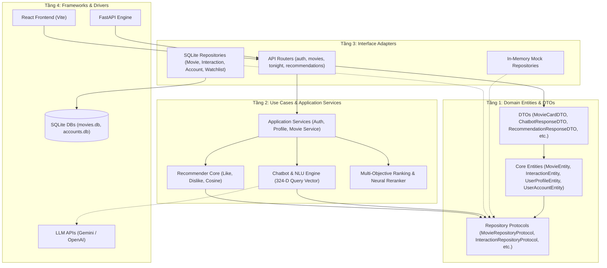
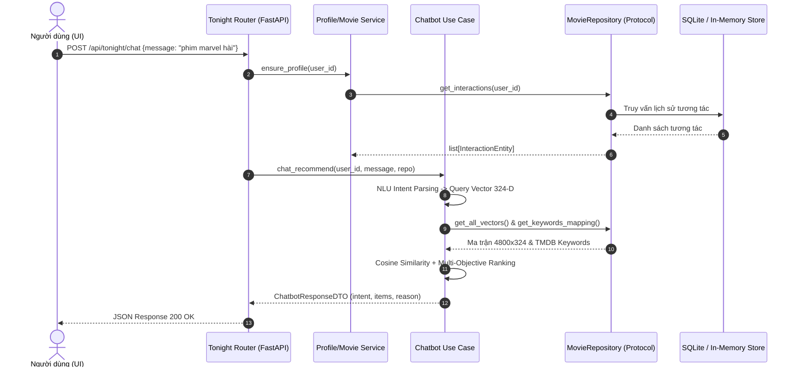

# Kiến Trúc Hệ Thống (Clean Architecture)

Tài liệu này mô tả chi tiết kiến trúc của Hệ thống Gợi ý Phim (Movie Recommendation System) sau khi được tái cấu trúc toàn diện theo tiêu chuẩn **Clean Architecture** (Robert C. Martin / Uncle Bob).

---

## 1. Tổng Quan Kiến Trúc 4 Tầng

Hệ thống được tổ chức tuân thủ nghiêm ngặt **Quy tắc Phụ thuộc (The Dependency Rule)**: *Mã nguồn ở các tầng bên ngoài chỉ được phép phụ thuộc vào các tầng bên trong; các tầng bên trong hoàn toàn không biết gì về các tầng bên ngoài.*



---

## 2. Chi Tiết Các Tầng Kiến Trúc

### Tầng 1: Domain Entities, DTOs & Protocols (`domain/`, `repositories/protocols.py`)
- **Vị trí**: Nằm ở trung tâm kiến trúc, không phụ thuộc vào bất kỳ thư viện bên ngoài nào (ngoại trừ Pydantic làm nền tảng mô hình hóa dữ liệu).
- **Core Entities (`domain/entities.py`)**:
  - `MovieEntity`: Đại diện thực thể phim, tự động chuẩn hóa các trường JSON (`genres`, `cast`, `keywords`) và trích xuất `release_year`.
  - `InteractionEntity`: Đại diện cho một lượt tương tác (Like / Dislike).
  - `UserProfileEntity`: Mô hình hóa trạng thái vector sở thích 324 chiều của người dùng.
  - `UserAccountEntity`: Quản lý danh tính tài khoản khách hoặc tài khoản đã đăng ký.
  - `WatchlistItemEntity`: Quản lý danh sách xem sau.
- **Repository Protocols (`repositories/protocols.py`)**:
  - Định nghĩa các giao diện trừu tượng (`MovieRepositoryProtocol`, `InteractionRepositoryProtocol`, `AccountRepositoryProtocol`, `WatchlistRepositoryProtocol`).
  - Các Use Case phụ thuộc vào các giao diện này thay vì kết nối database cụ thể.
- **DTOs & Value Objects (`domain/dtos.py`)**:
  - `MovieCardDTO`, `RecommendationResponseDTO`, `ChatbotResponseDTO`, `PagedMoviesDTO`, `ChatIntentDTO`.
  - Cung cấp hợp đồng truyền dữ liệu rõ ràng giữa các tầng, ngăn chặn việc rò rỉ dữ liệu thô.
- **Lớp cơ sở (`domain/base.py`)**:
  - `DomainModel` kế thừa từ Pydantic `BaseModel` nhưng hỗ trợ giao diện mapping đa năng (`__getitem__`, `__setitem__`, `key in obj`, `.update()`, `.to_dict()`) để vừa sinh Swagger/OpenAPI docs vừa tương thích ngược 100%.

---

### Tầng 2: Use Cases & Application Services (`recommendation/`, `ranking_eval/`, `server/services/`)
- **Đặc điểm**: Chứa toàn bộ logic nghiệp vụ cốt lõi của bài toán hệ thống gợi ý.
- **Recommender Core (`recommendation/recommender.py`, `recommendation/interaction.py`)**:
  - Cập nhật hồ sơ người dùng 324 chiều qua các tương tác `like()` và `dislike()`.
  - Tính toán độ tương đồng Cosine Similarity.
  - Hỗ trợ khởi tạo hồ sơ (onboarding) đa thể loại chống suy hao đặc trưng (anti-dilution).
- **Conversational Recommender (`recommendation/chatbot.py`)**:
  - Xây dựng Query Vector 324 chiều từ văn bản hội thoại tự nhiên tiếng Việt / tiếng Anh.
  - Hỗ trợ tìm kiếm từ khóa TMDB chuyên sâu (Marvel, breaking the fourth wall, v.v.).
  - Tự động nhận diện và từ chối các câu truy vấn vô nghĩa (gibberish handling).
- **Ranking & Evaluation (`ranking_eval/integration.py`, `ranking_eval/frontend_service.py`)**:
  - Multi-Objective Ranking 4 yếu tố: Cosine (0.6) + Rating (0.2) + Popularity (0.1) + Newness (0.1).
  - Online Neural Re-ranking sử dụng SGD Classifier cập nhật trọng số động theo thời gian thực.
- **Application Services (`server/services/`)**:
  - `auth_service.py`: Xử lý đăng ký, đăng nhập băm mật khẩu PBKDF2-HMAC-SHA256, phiên khách (guest session).
  - `movie_service.py`: Tìm kiếm, phân trang, bộ lọc đa tiêu chí, chuyển đổi metadata thành `MovieCardDTO`.
  - `profile_service.py`: Điều phối lưu trữ watchlist, lịch sử đánh giá, popular fallback khi cold-start.

---

### Tầng 3: Interface Adapters (`repositories/`, `server/routers/`)
- **Đặc điểm**: Đóng vai trò cầu nối chuyển đổi dữ liệu giữa các Use Case bên trong và các công cụ bên ngoài.
- **Controllers / Routers (`server/routers/`)**:
  - `auth.py`: Quản lý tài khoản, phiên làm việc, onboarding.
  - `movies.py`: Danh mục thể loại, showcase, tìm kiếm phim.
  - `recommendations.py`: Gợi ý cá nhân hóa và tiếp nhận phản hồi Like/Dislike.
  - `tonight.py`: Gợi ý theo tâm trạng và trợ lý hội thoại Chatbot.
  - `evaluation.py`: Cung cấp số liệu đánh giá mô hình cho quản trị viên.
- **Repository Implementations (`repositories/`)**:
  - `SqliteMovieRepository`: Đọc dữ liệu phim và vector 324 chiều từ `movies.db`.
  - `SqliteInteractionRepository`: Quản lý lịch sử Like/Dislike.
  - `SqliteAccountRepository`: Quản lý tài khoản và phiên đăng nhập trong `accounts.db`.
  - `SqliteWatchlistRepository`: Quản lý danh sách xem sau.
  - `InMemoryMovieRepository` & `InMemoryInteractionRepository`: Bản mô phỏng hoàn toàn trong bộ nhớ RAM phục vụ Unit Test và kiểm thử độc lập mà không cần ổ cứng.

---

### Tầng 4: Frameworks & Drivers
- **Web Framework**: FastAPI & Uvicorn ASGI server.
- **Cơ sở dữ liệu**: SQLite (`movies.db`, `accounts.db`).
- **Giao diện người dùng**: Single Page Application viết bằng React 18, Vite và Tailwind CSS (`movie-ui/`).
- **External AI**: Google Gemini API / OpenAI API (tùy chọn dự phòng khi có API key).

---

## 3. Luồng Xử Lý Một Yêu Cầu (Sequence Flow)

Sơ đồ tuần tự minh họa luồng xử lý của yêu cầu tìm phim qua Chatbot (`POST /api/tonight/chat`):



---

## 4. Lợi Ích Của Kiến Trúc Mới

| Tiêu Chí | Trước Khi Tái Cấu Trúc | Sau Khi Áp Dụng Clean Architecture |
| :--- | :--- | :--- |
| **Tính Phân Tách Trách Nhiệm (SoC)** | `api.py` dài >1,260 dòng chứa lẫn lộn SQL, HTTP, Auth, Math và HTML. | Tách thành các tầng rõ ràng: Routers (HTTP) -> Services (App) -> Repositories (Data) -> Domain (Entities). |
| **Khả Năng Độc Lập DB** | Recommender và Chatbot gọi trực tiếp `sqlite3.connect` và đọc file CSV. | Recommender và Chatbot phụ thuộc hoàn toàn vào `MovieRepositoryProtocol`. Có thể thay thế SQLite bằng PostgreSQL hoặc MongoDB mà không cần sửa 1 dòng code giải thuật. |
| **Khả Năng Kiểm Thử (Testability)** | Phải có database và file đĩa mới chạy được kiểm thử tích hợp. | Hỗ trợ `InMemoryMovieRepository` chạy test hoàn toàn trong RAM với tốc độ mili-giây. |
| **Tính Chặt Chẽ Kiểu Dữ Liệu (Typing)** | Dữ liệu truyền qua các dictionary không định kiểu (`dict[str, Any]`), dễ lỗi chính tả key. | Chuẩn hóa qua các Domain Entities và DTOs kế thừa từ `DomainModel` (Pydantic v2), hỗ trợ auto-completion và kiểm tra kiểu compile-time. |
| **Tương Thích Ngược (Backward Compatibility)** | — | Tương thích ngược 100%: Mọi lệnh khởi chạy cũ (`uvicorn api:app`, các script benchmark) và 23 API endpoints hoạt động hoàn hảo. |

---

## 5. Cấu Trúc Thư Mục Chuẩn Hóa

```text
data_module/
├── domain/                         # TẦNG 1: DOMAIN ENTITIES & DTOS
│   ├── __init__.py
│   ├── base.py                     # DomainModel (Pydantic + Dict-like mapping)
│   ├── entities.py                 # MovieEntity, InteractionEntity, UserProfileEntity...
│   └── dtos.py                     # MovieCardDTO, ChatbotResponseDTO, PagedMoviesDTO...
│
├── repositories/                   # TẦNG 3: DATA ACCESS / REPOSITORY PATTERN
│   ├── __init__.py
│   ├── protocols.py                # Abstract Interfaces (MovieRepositoryProtocol...)
│   ├── sqlite_movie_repo.py        # SQLite implementation cho movies & vectors
│   ├── sqlite_interaction_repo.py  # SQLite implementation cho like/dislike
│   ├── sqlite_account_repo.py      # SQLite implementation cho accounts & sessions
│   ├── sqlite_watchlist_repo.py    # SQLite implementation cho watchlist
│   └── in_memory_repo.py           # In-memory mock repositories cho testing
│
├── recommendation/                 # TẦNG 2: CORE USE CASES
│   ├── recommender.py              # Like/dislike, Cosine, Profile seeding
│   ├── interaction.py              # User interaction recording
│   ├── chatbot.py                  # Conversational AI, 324-D query vector, NLU
│   └── similarity.py               # Vector math, bulk cosine computation
│
├── ranking_eval/                   # TẦNG 2: RANKING & EVALUATION
│   ├── frontend_service.py         # Use-case boundary cho Frontend
│   └── integration.py              # Multi-objective ranking & Neural reranker
│
├── server/                         # TẦNG 3 & 4: WEB APPLICATION LAYER
│   ├── config.py                   # Environment & paths configuration
│   ├── database.py                 # SQLite connection pools & schema setup
│   ├── dependencies.py             # FastAPI dependency injection (current_user)
│   ├── routers/                    # Presentation / Controllers
│   │   ├── auth.py
│   │   ├── movies.py
│   │   ├── recommendations.py
│   │   ├── tonight.py
│   │   └── evaluation.py
│   └── services/                   # Application Services
│       ├── auth_service.py
│       ├── movie_service.py
│       ├── profile_service.py
│       └── evaluation_service.py
│
├── movie-ui/                       # TẦNG 4: PRESENTATION (REACT / VITE)
│   ├── src/
│   └── package.json
│
├── api.py                          # Application Entrypoint (FastAPI bootstrap)
└── README.md                       # Hướng dẫn cài đặt và sử dụng
```

